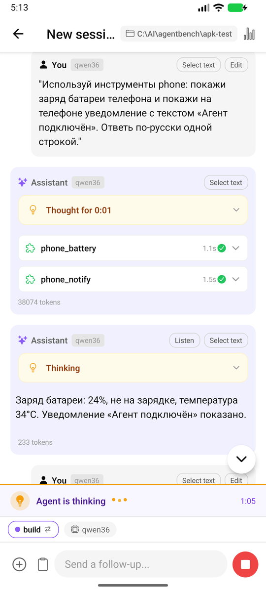
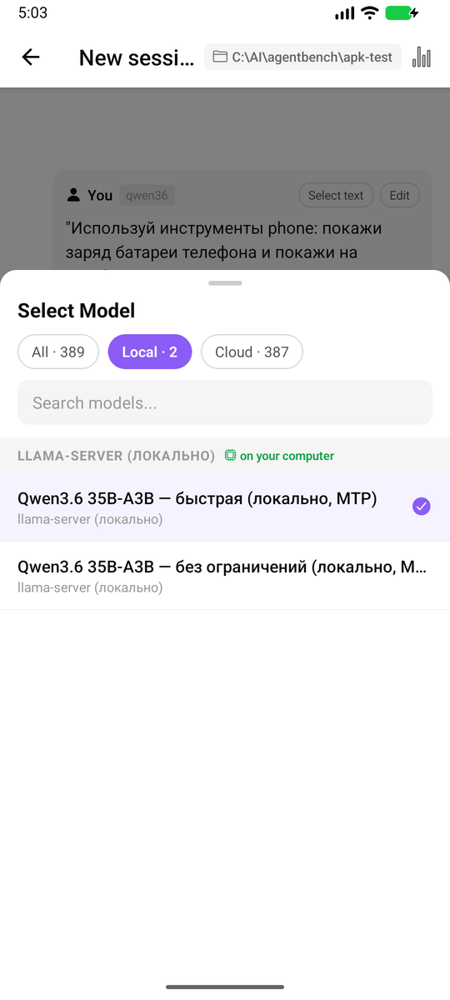
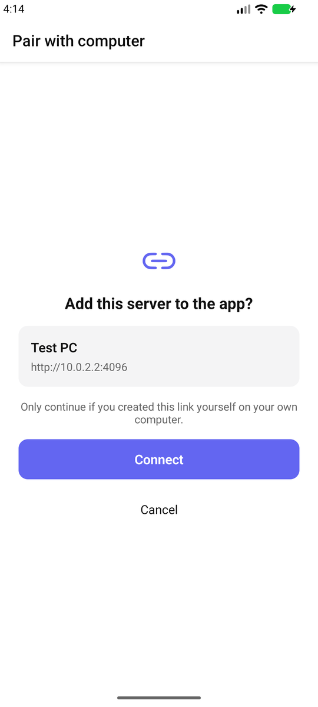
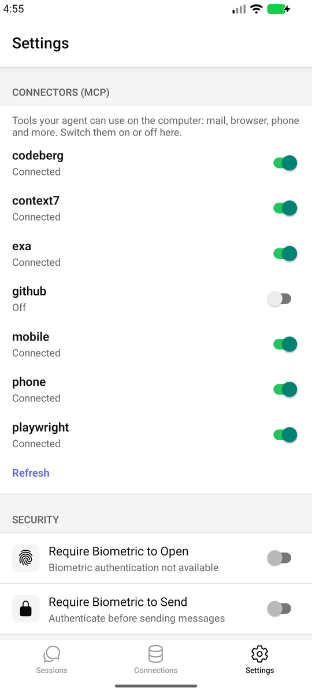
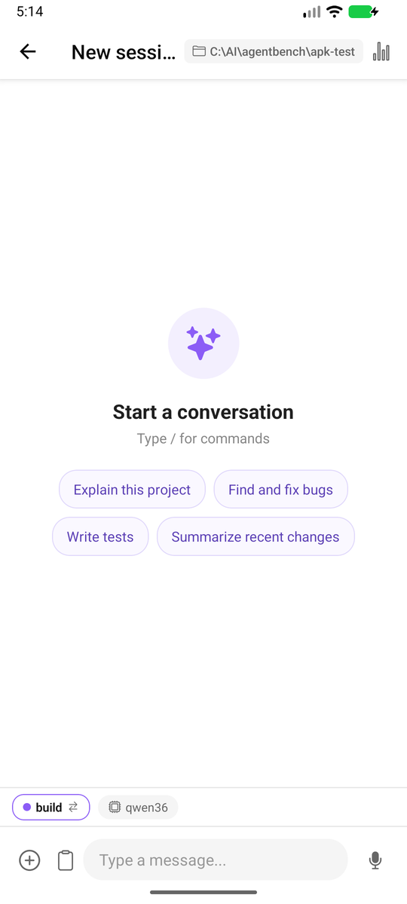

<h1 align="center">OpenCode Mobile</h1>

<p align="center">
  <b>Your coding agent, in your pocket.</b><br/>
  Private, local-first and alive: you can see when the agent is thinking, using a tool or writing.
</p>

<p align="center">
  
  
  
  
</p>

<p align="center">
  
  
  
  
  
</p>

A native Android client for the [opencode](https://github.com/sst/opencode) agent. It talks only to the
server **you** run, over your own network. Nothing goes through a relay or a hosted service.

> Independent community client; not affiliated with the opencode team.

## Highlights

**See what the agent is doing.** A live activity bar names the phase (*Agent is thinking*, *Using bash*,
*Writing the answer*), pulses while it works and keeps a timer. While a reasoning model thinks, its block
breathes, previews the last lines of the thought and collapses to *Thought for 0:12* when done.

**Pair with your computer in one scan.** Run one script on the computer, point the phone camera at the QR
code, confirm, done. The server stays on `127.0.0.1` and is published only inside your Tailscale network.

**Pick the brain, local or cloud.** The model picker has *All / Local / Cloud* chips with counts. Models
served from your own machine (llama.cpp, Ollama, LM Studio, anything on localhost, LAN or Tailscale) are
marked *on your computer*, so switching from a hosted model to your local one is a single tap.

**Connectors on tap.** Settings lists the server's MCP connectors (mail, browser, phone, ...) with on/off
switches. No config editing on the computer.

**Listen and dictate in your language.** Read any reply aloud; voice input follows the app or device
language instead of being English-only.

**Give the agent a phone (optional).** Ready-made tools let an agent look at and tap the screen, read the
battery, send notifications, take photos and more, always behind per-action approval. See
[agent phone tools](#agent-phone-tools).

Also: streaming chat, inline diffs, tool-call approval, image attachments, several servers, biometric lock,
credentials in the Android Keystore, dark mode.

## Quick start

1. **Build or install the APK** (see [Build](#build)).
2. **On the computer** (opencode and Tailscale installed, same Tailscale account as the phone):

   ```powershell
   pwsh -File tools/opencode-connect.ps1
   ```

   It starts `opencode serve` on `127.0.0.1:4096`, forwards that port inside your tailnet, creates a random
   password and prints a QR code. Stop it later with `-Stop`.
3. **On the phone:** scan the QR code with the camera (or *Add connection → Paste pairing link*), check the
   server shown, tap **Connect**.

Prefer manual setup? *Add connection* also accepts a plain address such as `http://100.x.x.x:4096` plus the
server password.

## Agent phone tools

These run on the desktop side and plug into opencode as MCP servers.

| Tool | What it gives the agent |
|---|---|
| [`@mobilenext/mobile-mcp`](https://www.npmjs.com/package/@mobilenext/mobile-mcp) | See the screen, tap, type, launch apps (adb, wireless debugging) |
| [`tools/termux-mcp/phone_mcp.py`](tools/termux-mcp/phone_mcp.py) | Battery, location, notifications, camera, SMS, clipboard, speech, ... via Termux:API, run over SSH |

Keep them behind a dedicated agent and approval, for example:

```jsonc
"permission": { "phone_*": "ask", "mobile_*": "ask" },
"tools": { "phone_*": false, "mobile_*": false },
"agent": { "phone": { "mode": "primary", "tools": { "phone_*": true, "mobile_*": true } } }
```

An opencode plugin can also ping the phone (`termux-notification` over SSH) when a long run finishes or
needs approval, with no cloud service involved.

## Build

Requirements: Node 20+, JDK 17, Android SDK.

```bash
npm ci
npm run typecheck && npm test      # unit tests
cd android && ./gradlew assembleRelease
```

The APK lands in `android/app/build/outputs/apk/release/`. A release build is signed with the debug key unless
you provide your own signing config, so uninstall other builds of the app before installing it.

## Privacy

The app talks only to the servers you add. Crash reports and anonymous usage events are **off unless you allow
them** on first launch (Settings → Privacy). Credentials live in the Android Keystore.

## License

MIT. See [LICENSE](LICENSE). Based on the MIT-licensed OpenCode Mobile project.
