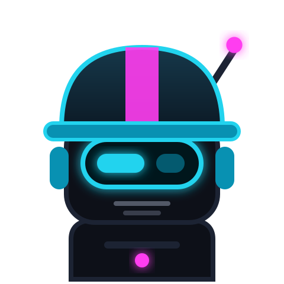
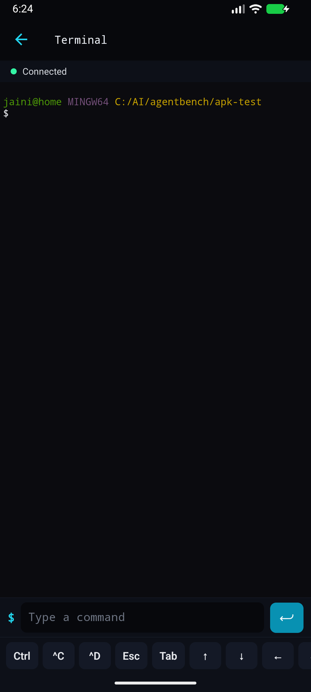
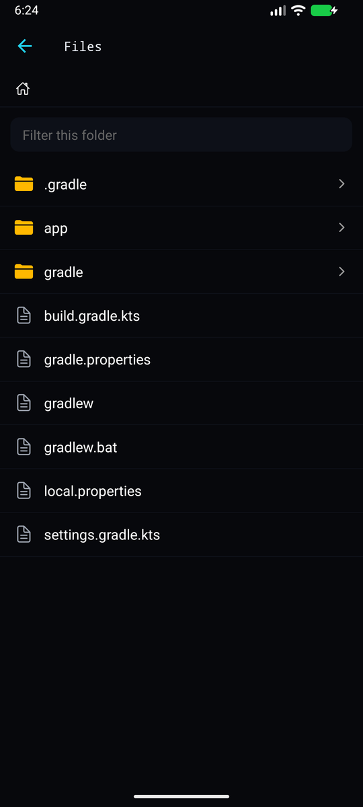

<p align="center">
  
</p>

<h1 align="center">OpenCode Mobile</h1>

<p align="center">
  <b>Cebinizdeki kodlama ajanı.</b><br/>
  Ajanın düşündüğünü, çalıştığını ve yazdığını gördüğünüz koyu, minimal, neon kenarlı bir istemci.
</p>

<p align="center">
  <a href="../../README.md">English</a> ·
  <a href="README.ru.md">Русский</a> ·
  <a href="README.zh-Hans.md">中文</a> ·
  <a href="README.es.md">Español</a> ·
  <a href="README.de.md">Deutsch</a> ·
  <a href="README.fr.md">Français</a> ·
  <a href="README.pt.md">Português</a> ·
  <a href="README.ja.md">日本語</a> ·
  <a href="README.ko.md">한국어</a> ·
  <a href="README.uk.md">Українська</a> ·
  <b>Türkçe</b>
</p>

<p align="center">
  
  
  
  
  
</p>

[opencode](https://github.com/sst/opencode) ajanı için yerel bir Android istemcisi. Yalnızca **sizin** çalıştırdığınız sunucuyla, kendi ağınız üzerinden konuşur. Hiçbir şey bir aktarıcıdan veya barındırılan bir hizmetten geçmez.

> Bağımsız topluluk istemcisi; opencode ekibiyle bağlantılı değildir.

## Öne çıkanlar

**Ajanın ne yaptığını görün.** Canlı etkinlik çubuğu aşamayı (“Ajan düşünüyor”, “bash kullanıyor”, “Yanıtı yazıyor”) söyler ve süre tutar; akıl yürütme bloğu “0:12 düşündü” olarak kapanır.

**Tek taramayla eşleştirme.** Bilgisayarda bir betik çalıştırın, kamerayı QR koduna tutun, onaylayın. Sunucu `127.0.0.1` üzerinde kalır ve yalnızca Tailscale ağınızda yayımlanır.

**Modeli seçin: yerel veya bulut.** “Tümü / Yerel / Bulut” filtresi; kendi makinenizdeki modeller işaretlenir, geçiş tek dokunuş.

**Sunucuyu telefondan başlatın.** Bilgisayardaki sunucu kapalıysa uygulama bir “Başlat” düğmesi gösterir.

**Ajana her yerden yanıt verin.** İzin istediğinde her ekranda bir afiş çıkar; bildirimde de aynı düğmeler vardır.

**Onunla konuşun.** Kulaklığa dokunun: konuşun, yanıtı dinleyin, uygulama yeniden dinlesin.

**OpenCode’a paylaşma, oturumlarda arama ve sabitleme.**

**Terminal, dosyalar, MCP bağlayıcıları,** farklar, görsel ekleri, birden çok sunucu, biyometrik kilit, kimlik bilgileri Android Keystore’da.

## Üç adımda kurulum (yaklaşık iki dakika)

**[Sorun giderme içeren tam rehber](../INSTALL.tr.md)**

**1. Bilgisayar: tek bir komut yapıştırın.** PowerShell’de (Windows):

```powershell
& ([scriptblock]::Create((irm https://raw.githubusercontent.com/jainikdroid-bit/opencode-mobile/main/tools/opencode-connect.ps1)))
```

macOS / Linux, Terminal’de:

```sh
curl -fsSL https://raw.githubusercontent.com/jainikdroid-bit/opencode-mobile/main/tools/opencode-connect.sh | sh
```

Eksik olanları (Node.js, opencode, Tailscale) kurar, sizden Tailscale’e bir kez giriş yapmanızı ister, sunucuyu başlatır ve iki QR kodlu bir sayfa açar.

**2. Telefon: kurun.** İlk QR kodunu tarayın (veya [Releases](https://github.com/jainikdroid-bit/opencode-mobile/releases/latest) sayfasını açın), APK’yı indirip açın. Tailscale’i de kurun ve aynı hesapla giriş yapın.

**3. Telefon: eşleştirin.** Uygulamayı açın, **Eşleşmek için QR tara**’ya dokunun, ikinci QR koduna tutun, **Bağlan**’a dokunun.

Komutu yeniden çalıştırmak güvenlidir (çoğaltmaz, onarır). Tailscale istemiyor musunuz? `-Mode lan` (aynı Wi-Fi) veya `-Mode tunnel` (ücretsiz Cloudflare tüneli; ödünleşimler rehberde).

### Bir yapay zekâ ajanı yapsın

Ajanınıza (Claude Code, opencode, Codex, ...) şunu söyleyin: *“OpenCode Mobile’ı benim için kur, https://github.com/jainikdroid-bit/opencode-mobile/blob/main/docs/AI-SETUP.md adresini izle”*.

Tasarım, ajan için telefon araçları ve kaynaktan derleme [İngilizce README](../../README.md) içinde anlatılır.

## Gizlilik

Analitik yok, çökme raporu yok, hesap yok. Uygulama yalnızca eklediğiniz sunucularla konuşur. Diğer tek istek, güncellemeleri bildirmek için bu projenin GitHub sürümlerine günde bir kez yapılan isteğe bağlı kontroldür. Kimlik bilgileri Android Keystore’da tutulur.

## Lisans

MIT. [LICENSE](../../LICENSE) dosyasına bakın.
